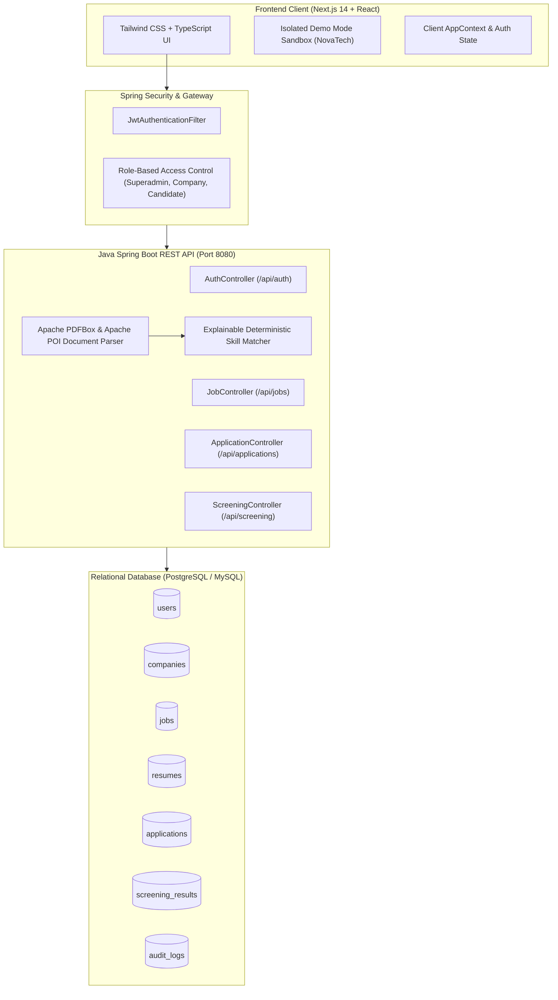

# AI Resume Screening System — Enterprise Recruitment Platform

A professional, full-stack recruitment and automated resume screening platform built for enterprise talent acquisition and college capstone demonstrations.

The system features **Next.js 14**, **React**, **TypeScript**, and **Tailwind CSS** on the frontend, with an architected **Java 17/21 Spring Boot 3** REST API backend utilizing **Apache PDFBox** and **Apache POI** for secure document parsing and deterministic, explainable skill matching.

---

## 📑 Table of Contents

1. [Project Overview & Key Features](#-project-overview--key-features)
2. [Technology Stack](#-technology-stack)
3. [System Architecture](#-system-architecture)
4. [Explainable Skill Matching Formula](#-explainable-skill-matching-formula)
5. [Quick Start & Setup Instructions](#-quick-start--setup-instructions)
6. [Demo Mode & NovaTech Solutions](#-demo-mode--novatech-solutions)
7. [Database Schema (Relational Models)](#-database-schema-relational-models)
8. [Java Spring Boot REST API Endpoints](#-java-spring-boot-rest-api-endpoints)
9. [College Viva Voce & Defense Guide](#-college-viva-voce--defense-guide)
10. [Implementation Stages Roadmap](#-implementation-stages-roadmap)

---

## 🌟 Project Overview & Key Features

- **Multi-Role Portals**: Dedicated workspaces for **Company / Recruiters** (NovaTech Solutions), **Candidates** (Alex Morgan), and **Superadmins** (system audits).
- **Explainable Screening**: No black-box AI hallucination. Deterministic skill comparison identifying exact matched keywords, missing criteria, and percentage scores.
- **Human-in-the-Loop Decisions**: Provides decision-support recommendations (`SHORTLISTED`, `UNDER_REVIEW`, `REJECTED`, `INTERVIEW`) rather than autonomous disqualification.
- **Multi-Format Ingestion**: Validated parsing of PDF files via **Apache PDFBox** and DOCX files via **Apache POI**.
- **Server-Enforced Role-Based Access Control (RBAC)**: Strict tenant isolation so recruiters cannot view competitor candidate submissions.
- **Isolated Demo Sandbox**: Pre-populated with realistic fictional data from **NovaTech Solutions** for live evaluator inspection.

---

## 🛠 Technology Stack

| Layer | Technologies |
|---|---|
| **Frontend UI** | Next.js 14 (App Router), React 18, TypeScript, Tailwind CSS, Lucide Icons |
| **Backend API** | Java 17/21, Spring Boot 3.3, Spring Security, Spring Data JPA |
| **Document Processing** | Apache PDFBox 3.0.3 (PDF), Apache POI 5.2.5 (DOCX) |
| **Database** | PostgreSQL 15+ / MySQL 8.0+ |
| **Authentication** | Stateless JWT (jjwt 0.12.5), BCrypt Password Hashing |
| **Hosting & CI/CD** | Vercel (Frontend), Docker / AWS / Render (Java Backend), GitHub Actions |

---

## 📐 System Architecture



---

## 🧮 Explainable Skill Matching Formula

The platform computes candidate compatibility using a transparent mathematical formula:

$$\text{Match Percentage} = \left( \frac{|\,S_{\text{matched}}\,|}{|\,S_{\text{required}}\,|} \right) \times 100$$

Where:
- $S_{\text{required}}$ is the set of mandatory technical competencies designated for the job posting.
- $S_{\text{matched}}$ is the verified subset of required keywords extracted from the candidate's PDF or DOCX resume document.
- Token comparison normalizes punctuation, ignores case differences, and eliminates duplicate counting.

### Classification Thresholds:
- **$\ge 80\%$ Match**: Shortlist Recommended
- **$50\% - 79\%$ Match**: Moderate Match (Manual Recruiter Review Required)
- **$< 50\%$ Match**: Low Match Profile (Respectful notification with skill gap recommendations)

---

## 🚀 Quick Start & Setup Instructions

### 1. Prerequisites
- **Node.js**: v18.17+ or v20+ installed
- **npm** or **pnpm**
- **Java JDK**: 17 or 21 installed
- **Apache Maven**: 3.8+ (for Spring Boot backend)
- **PostgreSQL** or **MySQL** (for production persistence)

### 2. Running the Frontend (Stage 1 Interactive Preview)
```bash
# Navigate to frontend
cd frontend

# Install dependencies (already completed)
npm install

# Start local Next.js dev server
npm run dev
```
Open [http://localhost:3000](http://localhost:3000) in your browser.

### 3. Running the Java Spring Boot Backend (Stage 2)
```bash
# Navigate to backend
cd backend

# Compile and launch Spring Boot application
mvn spring-boot:run
```
The REST API will be available at [http://localhost:8080/api](http://localhost:8080/api).

---

## 🏢 Demo Mode & NovaTech Solutions

The system includes a dedicated **Demo Mode** with fictional company **NovaTech Solutions**:
- **NovaTech Recruiter**: Manage job openings, review incoming resumes, and inspect skill match breakdowns.
- **Candidate (Alex Morgan)**: View candidate portal, test PDF/DOCX file uploading, apply for roles, and track status.
- **Superadmin**: Audit logs, approve pending tenant companies (e.g. BioHealth Cloud), and monitor system metrics.

Click **Demo Login** in the navigation header or visit `/demo` to switch between roles anytime!

---

## 📊 Database Schema (Relational Models)

The SQL DDL schema is provided at `database/schema.sql`. It defines:
- `users`: ID, email, BCrypt password hash, role (`SUPERADMIN`, `COMPANY`, `CANDIDATE`), status.
- `companies`: Legal name, industry, headquarters, contact email, verification status (`APPROVED`, `PENDING_APPROVAL`).
- `candidates`: User link, full name, headline, contact, normalized skills list.
- `resumes`: Binary storage path, file size, MIME type, UTF-8 extracted text stream.
- `jobs`: Title, department, description, responsibilities, mandatory skills, salary, deadline, status.
- `applications`: Relational link between Job, Candidate, and Resume with hiring status history.
- `screening_results`: Match score percentage, matched skills list, missing skills list, documented formula.
- `audit_logs`: Immutable security action log tracking actor, role, timestamp, and event description.

---

## 📡 Java Spring Boot REST API Endpoints

| Method | Endpoint | Access Role | Description |
|---|---|---|---|
| `POST` | `/api/auth/register` | Public | Register new candidate or pending company |
| `POST` | `/api/auth/login` | Public | Authenticate and retrieve JWT token |
| `GET` | `/api/jobs` | Public | Retrieve published job listings |
| `GET` | `/api/jobs/{id}` | Public | Retrieve job details and requirements |
| `POST` | `/api/jobs` | `COMPANY` | Create a new job opening |
| `POST` | `/api/resumes/upload` | `CANDIDATE` | Upload PDF/DOCX resume & extract text via PDFBox/POI |
| `POST` | `/api/applications/apply` | `CANDIDATE` | Submit job application |
| `POST` | `/api/screening/evaluate` | `COMPANY` | Run deterministic skill scoring on application |
| `PATCH` | `/api/applications/{id}/status` | `COMPANY` | Update status (`SHORTLISTED`, `REJECTED`, etc.) |
| `GET` | `/api/admin/companies` | `SUPERADMIN` | Review all registered companies |
| `PATCH` | `/api/admin/companies/{id}/approve` | `SUPERADMIN` | Approve company tenant registration |
| `GET` | `/api/admin/audit-logs` | `SUPERADMIN` | Retrieve immutable security audit records |

---

## 🎓 College Viva Voce & Defense Guide

### Top Viva Questions & Answers:
1. **Q: Why Java Spring Boot instead of Python?**  
   *A:* Java Spring Boot offers rock-solid enterprise stability, server-enforced type safety, and robust security via Spring Security. Document processing is handled cleanly using Apache PDFBox and Apache POI.
2. **Q: How does text extraction work for DOCX vs PDF?**  
   *A:* PDF files are parsed via `org.apache.pdfbox.text.PDFTextStripper`. Word documents are parsed via `org.apache.poi.xwpf.extractor.XWPFWordExtractor`.
3. **Q: How is tenant data privacy guaranteed?**  
   *A:* Multi-tenancy is enforced on the backend. When a company requests candidate records, Spring Boot validates the company ID extracted from the authenticated JWT against the job's owning company.
4. **Q: Is this an unexplainable black-box AI?**  
   *A:* No. This release emphasizes explainable, auditable, and transparent algorithmic scoring. Every match percentage is documented with the exact matched skills and missing skills.

---

## 📌 Implementation Stages Roadmap

- [x] **Stage 1 (Completed)**: Full frontend experience (Homepage, Login, Demo Role Selection, Superadmin Dashboard, NovaTech Company Dashboard, Candidate Portal, Public Job Results, and Interactive Resume Screening Lab).
- [ ] **Stage 2 (Next)**: Initialize Java Spring Boot backend project with Spring Data JPA & database connection.
- [ ] **Stage 3**: Real Spring Security JWT authentication and role-based access control.
- [ ] **Stage 4**: Company, candidate profile, job creation, and application management services.
- [ ] **Stage 5**: Apache PDFBox / POI file upload handling and Java-based resume screening engine.
- [ ] **Stage 6**: Wire frontend API client directly to Spring Boot REST endpoints.
- [ ] **Stage 7**: Integration tests, role boundary verification, and load testing.
- [ ] **Stage 8**: Production deployment setup (Vercel + Java cloud hosting).
